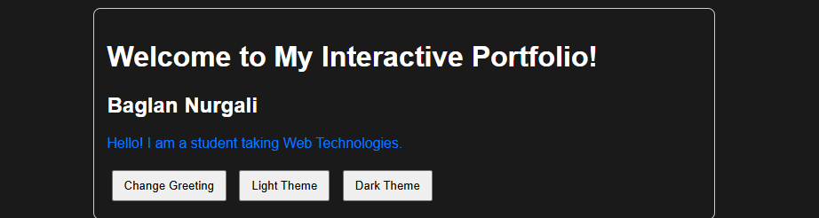
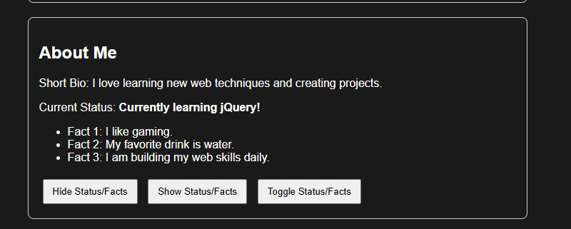
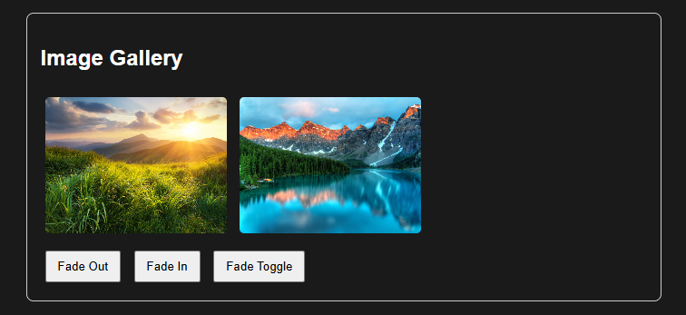
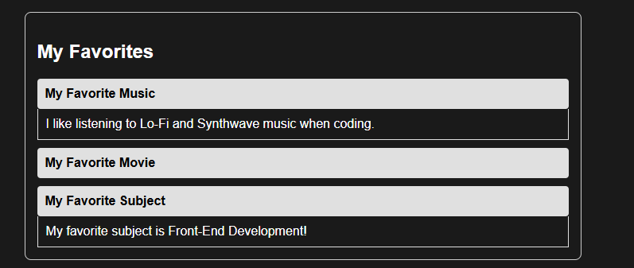
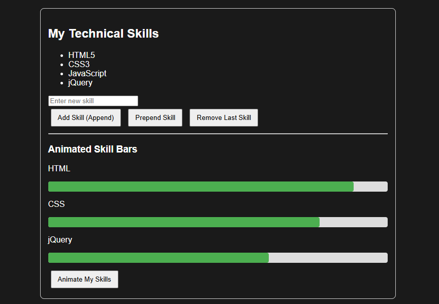
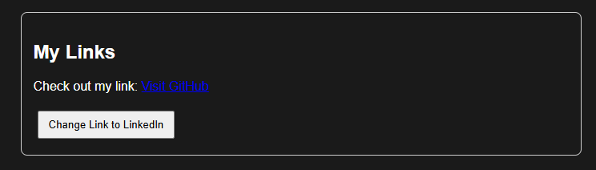
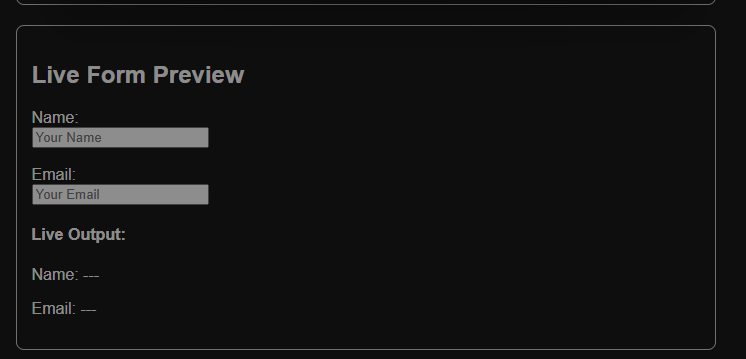

Baglan Nurgali

Group: IT-2501

Website: https://baglan-nurgali.github.io/Web_asnm6

GitHub: https://github.com/baglan-nurgali/Web_asnm6

Assignment Overview & Tasks

This assignment demonstrates basic jQuery concepts including DOM selectors, manipulation, effects, and animations.

Part 1. Getting Started with jQuery

Task 0. Setup

CDN link included in <head>.

$(document).ready() implemented with console check "jQuery is ready!".

Task 1. Selectors & CSS

Displayed personal info and portfolio heading.

Dynamically changed text using .text() and updated element styles using .css() / .addClass().

Theme switcher buttons toggle between Light and Dark themes.

Screenshot:

Part 2. jQuery Effects

Task 2. Visibility Methods

Used .hide(), .show(), and .toggle() to manage visibility for status message and fun facts.

Screenshot:

Task 3. Fade Methods

Managed gallery image visibility using .fadeIn(), .fadeOut(), and .fadeToggle().

Screenshot:

Task 4. Slide Methods

Implemented collapsible accordion items using .slideToggle().

Screenshot:

Part 3. DOM Manipulation with jQuery

Task 5. Add & Remove Elements

Dynamic list modification using .append(), .prepend(), and .remove(). Included validation to block empty inputs.

Screenshot:

Task 6. Modifying Attributes

Modified the social media link URL and text dynamically using .attr().

Screenshot:

Task 7. Form Interaction

Used .val() and .text() attached to keyup events for real-time live input previewing.

Screenshot:

Part 4. Animations

Task 8. Basic Animation

Used .animate() to adjust CSS widths of skill bar elements smoothly. Includes toggle logic to return widths to 0% on alternating clicks.

Screenshot:

Work Process Summary

Setup: Integrated CDN script and added basic console log.

HTML & CSS: Built a clean single-page container section for each assignment task.

jQuery Implementation: Added click events to trigger jQuery functions step-by-step according to requirements.

Validation & Testing: Tested input checking to block empty skills and ensured theme toggling functions smoothly.

Deployment: Pushed source code to GitHub repository and enabled GitHub Pages.
